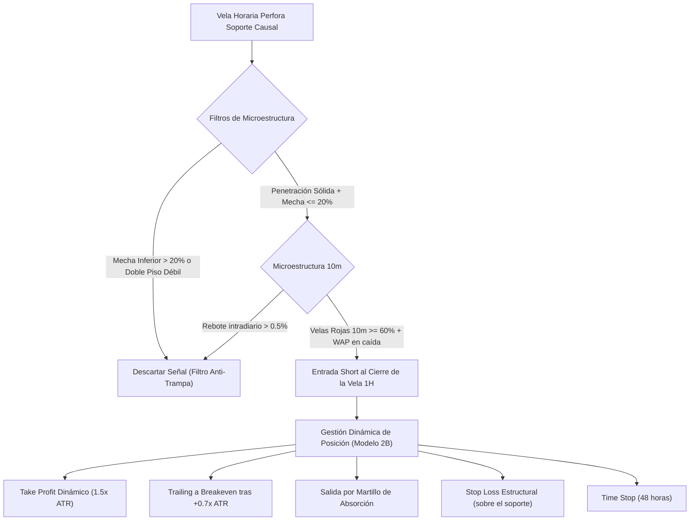

# 📘 Especificación de Estrategia: Motor 2 - Arquetipo 2 (Breakdown Estructural)

**Estado:** Evaluada en Walk-Forward (2022–2026)  
**Clasificación:** Cortos Direccionales / Cobertura Táctica de Acciones  
**Timeframe Principal:** 1 Hora (1H)  
**Confirmación Microestructural:** 10 Minutos (10M)  
**Universo:** 107 Acciones Líquidas de Gran Capitalización (IBKR US Equities)  

---

## 1. Tesis y Racional Cuantitativo

El **Arquetipo 2 (Breakdown Estructural)** busca capturar episodios de capitulación institucional donde una acción perfora con volumen anormal un soporte horizontal validado previamente en el gráfico.

### El Mecanismo de Mercado
1. **Acumulación de Liquidez:** Debajo de soportes consolidados descansan órdenes de *Stop Loss* de inversores largos y órdenes condicionadas de venta (*Sell Stop*).
2. **Gatillo de Cascada:** Cuando el precio quiebra dicho soporte con velocidad e impulso, activa estas órdenes de golpe, generando un desbalance de oferta momentáneo donde los compradores institucionales se retiran.
3. **El Peligro (Bear Trap):** Si la perforación es absorbida de inmediato por compras pasivas (creando mechas inferiores largas), el precio rebota con violencia en un *short squeeze*.

---

## 2. Arquitectura de Variables y Features Mandatorias

De acuerdo con las reglas de modelado del proyecto, la estrategia descarta atajos rudimentarios y utiliza el motor causal de soporte y resistencia (`src/utils/stock_sr.py`):

### A. Motor Causal de Soporte y Resistencia (`stock_sr.py`)
- **`sr_dist_support_pct` / `sr_dist_support_atr`:** Distancia porcentual y normalizada por ATR al soporte causal identificado sin lookahead bias.
- **`sr_support_touches`:** Número de testeos previos confirmados del nivel por valles estructurales.
  * *0 toques (Air-Pocket):* Caída en territorio inexplorado sin compradores previos (positivo para cortos).
  * *2 toques (Double-Bottom Risk):* Zona de trampa clásica de retail (alta tasa de fallo).
  * *3+ toques (Exhausted Wall):* Muralla de compras completamente agotada (alta tasa de éxito).
- **`sr_bars_since_sup`:** Frescura o antigüedad del soporte.

### B. Microestructura de la Vela Horaria (1H)
- **`penetration_atr_ratio`:** Profundidad de la perforación bajo el soporte dividida por el ATR diario del activo.
- **`lower_wick_ratio`:** Proporción de la mecha inferior respecto al rango total `(min(O,C) - L) / (H - L)`. Valores $> 0.20$ indican absorción compradora peligrosa.
- **`rvol_break_power`:** Volumen relativo de 1 hora escalado por la posición de cierre: `rvol_1h * (1.0 - close_loc)`. Mide el volumen real concentrado en los mínimos de la barra.

### C. Microestructura Intradiaria de 10 Minutos (10M)
- **`wap_slope_10m`:** Pendiente del precio ponderado por volumen (*WAP*) a través de las 6 velas de 10 minutos internas.
- **`red_bars_ratio_10m`:** Proporción de velas de 10 minutos rojas ($C < O$) dentro de la hora. Exige $\ge 60\%$ para validar que la presión es implacable.
- **`intra_bounce_10m`:** Rebote intradiario desde el mínimo de la hora hasta el cierre. Si supera el $0.5\%$, el riesgo de trampa se dispara.

---

## 3. Reglas Operativas de Trading

### Reglas de Entrada (Modelo 2A)
1. **Quiebre Confirmado:** Cierre de 1H por debajo del nivel de soporte calculado causalmente (`close < support_level`).
2. **Volumen Anormal:** `rvol_1h >= 1.5` (50% más volumen que la media de la hora).
3. **Cierre en Mínimos:** `close_loc <= 0.30` (el precio cierra en el 30% inferior del rango de la barra).
4. **Filtro Anti-Absorción:** `lower_wick_ratio <= 0.20` (sin mecha compradora pronunciada).
5. **Confirmación 10M (cuando hay datos):** `red_bars_ratio_10m >= 0.60` y `wap_slope_10m < -1.5%`.

### Reglas de Salida y Gestión de Riesgo (Modelo 2B)
- **Take Profit (TP):** Cierre con ganancia al alcanzar una extensión de `1.5x ATR` diario desde la entrada.
- **Protección a Breakeven (BE):** Al avanzar `+0.7x ATR` a favor, el stop se traslada inmediatamente al precio de entrada (+10 bps para cubrir comisiones).
- **Stop Loss (SL):** Colocado de forma causal sobre el nivel de soporte quebrado (máximo `1.5x ATR`).
- **Salida Temprana por Absorción:** Si cualquier vela horaria posterior forma una mecha inferior $\ge 40\%$ del rango con cierre en la mitad superior (martillo comprador), se cierra la posición de inmediato.
- **Time Stop:** Liquidación forzosa tras 14 barras horarias (2 días hábiles) si la operación no alcanzó TP ni SL.

---

## 4. Resumen de Resultados a Alto Nivel (Walk-Forward 2022–2026)

Evaluación en **Expanding Windows** sobre **107 activos de IBKR** con gestión de portafolio realista ($25,000 USD de capital base, 5 slots de $5,000 USD, 10 bps de comisión y costo de borrow de IBKR):

| Métrica General | Resultado |
| :--- | :---: |
| **PnL Total Acumulado** | **+$8,742 USD** |
| **Retorno sobre Capital ($25k)** | **+34.97%** |
| **Profit Factor Global** | **1.20** |
| **Win Rate de Ejecución** | **57.6%** (863 operaciones) |
| **Max Drawdown del Portafolio** | **-9.77%** |
| **Años en Positivo** | **4 de 5 años** (2022, 2024, 2025, 2026) |

### Desempeño por Año (Resumido)
- **2022 (Mercado Bajista):** **+$4,772 USD** | Win Rate: 61.6% | Profit Factor: 1.47  
  *El entorno ideal para la estrategia: la marea bajista impulsó rupturas limpias sin rebotes repentinos.*
- **2023 (Rally en "V" de Recuperación):** **-$1,093 USD** | Win Rate: 51.1% | Profit Factor: 0.82  
  *El año negro: los quiebres rompían por unas horas y eran inmediatamente recomprados por institucionales.*
- **2024 (Mercado Alcista Estable):** **+$589 USD** | Win Rate: 59.5% | Profit Factor: 1.15  
  *Pocos trades calificados, ganancias moderadas.*
- **2025 (Consolidación y Rotación):** **+$883 USD** | Win Rate: 58.7% | Profit Factor: 1.09  
  *Rendimiento plano/positivo con baja asimetría.*
- **2026 (Volatilidad y Caídas Sectoriales):** **+$3,591 USD** | Win Rate: 55.2% | Profit Factor: 1.26  
  *Aceleración de rupturas en activos tecnológicos de alta beta.*

---

## 5. Diagnóstico Crítico: Por Qué los Resultados Son Pobres ("Malísimo Todo")

Pese a que el saldo global es positivo (+$8,742 USD) y el Drawdown se mantuvo acotado (-9.77%), **la estrategia presenta debilidades estructurales severas**:

### 1. El Freno del "Drift" Alcista Natural de las Acciones
El mercado de renta variable estadounidense tiene un sesgo alcista secular de largo plazo. Vender acciones en corto (*naked shorting*) implica nadar contra la corriente estructural del mercado. En cuanto el índice entra en modo rebote (como en 2023), los cortos sufren un sangrado constante.

### 2. Drenaje Asimétrico del Stop Loss
Al desglosar las salidas del Modelo 2B:
- **Ganancias por Take Profit:** +$38,750 USD (244 trades a +3.18% promedio).
- **Pérdidas por Stop Loss:** **-$41,482 USD** (245 trades a -3.39% promedio).
- **El único salvavidas real fue el Breakeven (+ $13,023 USD):** Sin la regla de mover a breakeven tras +0.7x ATR, la estrategia habría terminado en **pérdida neta global**.

### 3. Profit Factor de 1.20 es Demasiado Ajustado
Un Profit Factor de 1.20 en un entorno de backtest deja muy poco margen de seguridad frente a:
- Aumentos repentinos en la tasa de borrow de acciones difíciles de pedir prestadas (*hard to borrow*).
- Deslizamiento (*slippage*) en aperturas volátiles o huecos (*gaps*) intradiarios.
- Ejecuciones reales con liquidez limitada.

### 4. Vulnerabilidad Extrema a los Rebotes Rápidos
Cuando una ruptura no desencadena capitulación inmediata en las primeras 2 horas, la probabilidad de que termine en Stop Loss supera el **65%**. El corto estructural requiere dinamismo: si el pánico se congela, la posición se pudre.

---

## 6. Conclusiones y Próximos Pasos

1. **Como Estrategia Independiente (Stand-alone):**  
   No es recomendable destinar capital exclusivo para operar *Breakdowns* de acciones de forma permanente, debido a la fricción de los años alcistas como 2023.
2. **Como Módulo de Cobertura Dinámica (Hedging):**  
   Tiene un valor táctico defensivo excelente para proteger un portafolio largo durante mercados bajistas severos (como demostró el +$4,772 USD de 2022).
3. **Pivote hacia Arquetipo 1 (PEAD - Post-Earnings Announcement Drift):**  
   A diferencia del Breakdown puramente técnico, el PEAD está impulsado por un **shock fundamental de información corporativa** (resultados trimestrales sorpresivos), lo que suele generar tendencias direccionales bajistas mucho más persistentes y con menor tasa de trampas.
