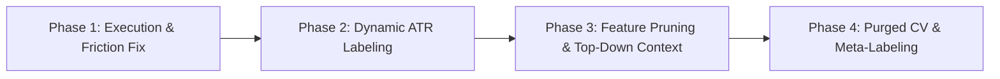

# Quantitative Trading System: Architecture, Issues & Structural Transformation Plan

This document outlines the diagnostic findings of previous system performance, the quantitative pitfalls of the current architecture, and a comprehensive 4-phase transformation roadmap to convert the codebase into a robust, institutional-grade automated trading agent.

---

## 🔍 Part 1: Diagnostic & Root Causes of Previous Failures

### 1. Market Friction vs. Ultra-Tight Fixed Stops
* **Issue**: The original execution utilized an ultra-narrow 2-pip Stop Loss (`STOP_LOSS_PIPS = 2.0`). In real-world Forex execution, broker spread (0.2–1.2 pips on EUR/USD), slippage, and IBKR commission immediately consumed 50% to 100% of the risk buffer.
* **Impact**: Normal micro-structure tick vibration stopped out positions almost instantly before any directional alpha could materialize.

### 2. The "600-Indicator" Noise Monster (Severe Overfitting)
* **Issue**: The training dataset expanded to over 600 features (dozens of SMA periods, slopes, accelerations, RSI variations, Stochastics, Bollinger Bands, and 15 lags of candlestick wicks/bodies).
* **Impact**: In financial time series, the Signal-to-Noise Ratio (SNR) is under 1%. Technical indicators are collinear transformations of the exact same 4 prices ($O, H, L, C$). Feeding 600 collinear features to a Random Forest or LightGBM forces trees to split on random historical noise, leading to catastrophic out-of-sample breakdown.

### 3. Fixed Pips vs. Non-Stationary Volatility
* **Issue**: Fixed pip targets (e.g., 10-pip SL / 25-pip TP) assume market volatility is static.
* **Impact**: During the London/New York overlap (ATR ~ 25 pips), a 10-pip SL is stopped out in one candle by routine noise. During the Asian session (ATR ~ 4 pips), a 25-pip target is virtually unreachable within an 18-candle horizon.

### 4. Midpoint Data vs. Execution Reality
* **Issue**: Historical bars were collected via IBKR using `whatToShow="MIDPOINT"`. Midpoint data contains zero spread and zero liquidity depth.
* **Impact**: Training on Midpoint without a spread penalty creates a fantasy backtest. Furthermore, bracket orders in `realtime_processor.py` calculated SL/TP prices from the prior candle's `close` before knowing the actual fill price of the market order.

---

## 🛠️ Part 2: The 4-Phase Transformation Roadmap

### Phase 1: Execution Engine & Order Synchronization
* [ ] **Synchronize Child Bracket Orders to Fill Prices**:
  - In `src/app/realtime_processor.py`, modify `_place_bracket_order` so child Stop Loss and Take Profit orders are pegged to the *actual fill price* (via `orderStatus` or `execDetails` callback) or switch to Limit entry orders.
* [ ] **Dynamic ATR-Based SL / TP**:
  - Replace static `STOP_LOSS_PIPS` and `TAKE_PROFIT_PIPS` with dynamic multipliers based on current 5m ATR (e.g., $SL = 1.5 \times ATR_{14}$, $TP = 3.0 \times ATR_{14}$, maintaining a 1:2 Risk/Reward).
* [ ] **Synthetic Spread Penalty**:
  - Ensure the backtester and feature engine apply at least a 0.8–1.0 pip conservative round-trip friction penalty (spread + commission) to every simulated trade.

### Phase 2: Dynamic Labeling (Triple Barrier Method)
* [ ] **Replace Fixed Pip Simulation**:
  - Refactor `evaluar_escenarios_trading` and `generate_target_variable` in `src/utils/exploration_utils.py`.
* [ ] **Implement Triple Barrier Logic**:
  1. **Upper Barrier**: $Price_{entry} + (k_{TP} \times ATR)$
  2. **Lower Barrier**: $Price_{entry} - (k_{SL} \times ATR)$
  3. **Vertical (Time) Barrier**: Max horizon of $N$ candles (e.g., 18 candles / 1.5 hours). If neither barrier is touched, the position is liquidated at market close of the $N$-th candle.

### Phase 3: Feature Pruning & Multi-Timeframe Context
* [ ] **Prune 600 Features Down to 20–30 Orthogonal Signals**:
  - Eliminate redundant lags of raw candle wicks and identical moving averages.
  - Retain strictly stationary, normalized features:
    1. **Normalized Returns**: Log returns over 1, 3, 6, 12, and 24 bars ($z$-scored).
    2. **Volatility Regime**: Ratio of short-term ATR to long-term baseline ($ATR_{14} / ATR_{100}$).
    3. **Oscillator Extremes**: Normalized distance from Bollinger Bands (%B) and 14-period RSI.
    4. **Dynamic S/R Proximity**: Distance to nearest Support/Resistance cluster divided by current ATR.
* [ ] **Add Top-Down Multi-Timeframe Features**:
  - 1-Hour Trend Direction (Slope of 1H 50 EMA).
  - 1-Hour RSI / Momentum state to prevent trading against higher-timeframe momentum.
* [ ] **Session & Time Context**:
  - Binary session flags: `is_london_open` (07:00–10:00 UTC), `is_ny_open` (12:00–16:00 UTC), `is_asian_session`.

### Phase 4: Purged Cross-Validation & Meta-Labeling Architecture
* [ ] **Purged & Embargoed Time-Series Cross-Validation**:
  - Eliminate data leakage caused by overlapping forward labeling windows. Ensure an embargo buffer between training and validation folds.
* [ ] **Adopt Meta-Labeling Pattern**:
  - **Level 1 (Primary Technical Filter)**: Generates candidate trade setups (e.g., S/R zone rejection with candle confirmation).
  - **Level 2 (Secondary ML Model)**: Binary LightGBM classifier predicts: *"Given this setup, will it hit the upper barrier before the lower barrier?"* (Filtering false breakouts).
* [ ] **Probability Calibration**:
  - Calibrate classifier outputs using `CalibratedClassifierCV` (isotonic regression) to ensure probability thresholds (>0.70) reflect true empirical probabilities.

---

## 📊 Part 3: Data Ingestion — How & Where to Get Bid/Ask Data

When running intraday quantitative strategies, dealing with the spread is critical. Three viable paths exist:

### 1. Direct Historical Bid & Ask Ingestion from IBKR (Most Accurate)
In `src/data_extraction/download_data.py`, IBKR's `reqHistoricalData` supports explicit quote types via `whatToShow`:
* `whatToShow="BID"`: Generates bars constructed exclusively from the Bid price.
* `whatToShow="ASK"`: Generates bars constructed exclusively from the Ask price.
* **Workflow**: Download both series for the target symbol and merge on timestamp. This produces exact bar-by-bar spread dynamics:
  $$\text{Spread}_t = \text{Ask\_Close}_t - \text{Bid\_Close}_t$$
* **Execution Simulation**: Long entries execute at `Ask_Close`, long exits execute at `Bid_Close` (and vice-versa for shorts).

### 2. Synthetic Bid/Ask Penalty on Midpoint Data (Fastest & Standard Quant Practice)
If downloading duplicate historical datasets is too bandwidth- or storage-intensive:
* Keep `whatToShow="MIDPOINT"` for historical bars.
* In the labeling function (`exploration_utils.py`), inject a synthetic friction model:
  $$\text{Effective Long Entry} = \text{Midpoint} + \frac{\text{Spread}_{\text{conservative}}}{2} + \text{Slippage}$$
  $$\text{Effective Long TP} = \text{Target Price} + \frac{\text{Spread}_{\text{conservative}}}{2}$$
  $$\text{Effective Long SL} = \text{Stop Price} - \frac{\text{Spread}_{\text{conservative}}}{2}$$
* Using a conservative spread of **1.0 to 1.5 pips** for EUR/USD guarantees that any model passing backtesting will be robust against live market friction.

### 3. Real-Time Streaming Quotes
In `src/app/realtime_processor.py`:
* Instead of or in addition to `reqRealTimeBars`, use `reqMktData(reqId, contract, "", False, False, [])`.
* Implement the `tickPrice` callback in `EWrapper` to listen for:
  - `TickType = 1` (Bid Price)
  - `TickType = 2` (Ask Price)
* This allows the bot to know the live spread before submitting orders.

---

## ⚖️ Part 4: Asset Class Evaluation — Forex vs. Stocks vs. Futures

| Dimension | Forex (EUR/USD, GBP/USD) | Stocks / ETFs (SPY, QQQ, Megacaps) | Micro Index Futures (MES, MNQ) |
| :--- | :--- | :--- | :--- |
| **Market Nature** | Zero-sum macro game; mean-reverting ranges punctuated by central bank/news shocks. | Positive long-term drift; structural accumulation by institutions. | Positive drift; institutional liquidity and continuous price discovery. |
| **Traded Volume** | **None** (OTC quotes only; tick volume is an approximation). | **Real Volume & VWAP** available (`whatToShow="TRADES"`). Volume surges provide high predictive power. | **Real Volume, Tick Count & Order Flow** available. |
| **Spread / Friction %** | Small nominal spread (0.5–1.0 pip), but high relative to daily price move (0.5%). Requires high leverage. | Penny spreads on SPY ($0.01 on $550 = 0.0018%). Spreads are negligible compared to daily moves (1.5%–3.0%). | $0.25 on $5,500 index = 0.0045%. Highly cost-efficient. |
| **Trading Hours** | 24 hours / 5 days continuous. No overnight gap issues. | 9:30 AM – 4:00 PM EST. Significant overnight gaps between market sessions. | 23 hours / 5 days continuous. Minimal gap risk; global liquidity. |
| **Regulatory / Margin** | High leverage (30:1–50:1), no Pattern Day Trader (PDT) rule. | Subject to PDT ($25k minimum for unlimited day trades) in US margin accounts. | No PDT rule; low day-trading margin requirements ($50–$500 per contract). |

### Strategic Recommendation on Asset Class:
1. **If Staying in Forex**: Focus exclusively on the **London / New York open sessions (07:00–16:00 UTC)**. Turn off trading during the low-liquidity Asian session where micro-spreads consume profitability.
2. **If Transitioning to Stocks/ETFs**: Highly viable. ETFs like **SPY** or **QQQ** provide real volume indicators (VWAP, Volume Breakouts), which are far more predictive for ML models than candlestick geometry. The only requirement is handling market session open/close boundaries.
3. **The Quant "Sweet Spot" (Micro Futures - MES/MNQ)**: Micro E-mini S&P 500 futures offer the best of both worlds: 23/5 continuous trading (like Forex) combined with real exchange-traded volume, institutional order flow, and razor-thin spreads (like Equities).
